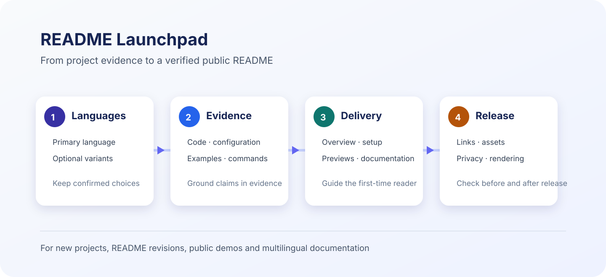

# README Launchpad

[简体中文](README.md) · [English](README.en.md)

**Help AI agents turn project facts into clear, credible GitHub READMEs that are easy to get started with.**

Use it to create a landing page, refresh an entire README, fix specific sections or audit documentation. Start with what the product does now, then organize results, capabilities, installation and usage. Update stale content alongside new explanations so the page stays consistent.

[Install](#install) · [Use](#use) · [Full skill instructions](SKILL.md)

[](SKILL.md)

This is a workflow illustration, not a screenshot of a finished README. Click it for the execution rules.

## What it helps you do

- **Build a reader journey:** help first-time visitors understand the project, judge a credible result and find a useful starting point, without imposing a fixed section template.
- **Maintain the whole page:** reconcile positioning, examples, commands and limits with current behavior; consolidate duplicate explanations and leave release history to release notes.
- **Verify rather than invent:** inspect source, configuration and available examples; distinguish supported capabilities and tested commands from unverified claims.
- **Choose useful demonstrations:** use screenshots, diagrams or clickable previews, clearly separating real outputs from illustrations and linking to usable demos or sources.
- **Keep languages aligned:** preserve selected primary and optional languages while updating copy, captions, links and limitations together.
- **Check public-facing content:** check local targets and common sensitive-text patterns; keep attribution concise while preserving required notices.

A general refresh reviews the entire page. A targeted request stays within its stated scope instead of rewriting unrelated sections.

## Install

Requires an agent that can read repositories, edit files and execute local commands. Installation uses Git; the mechanical validator needs only the Python 3 standard library. No API key or extra Python packages are required.

Install in Codex:

```bash
mkdir -p "${CODEX_HOME:-$HOME/.codex}/skills"
git clone https://github.com/Zimzheng/readme-launchpad.git "${CODEX_HOME:-$HOME/.codex}/skills/readme-launchpad"
```

Save local modifications before updating an existing clone:

```bash
cd "${CODEX_HOME:-$HOME/.codex}/skills/readme-launchpad"
git pull --ff-only
```

For other agents supporting `SKILL.md`, load the complete skill directory according to their configuration. Retain `agents/`, `references/`, `scripts/` and `assets/`; discovery mechanisms and paths depend on the host.

## Use

```text
Use $readme-launchpad to refresh this repository's entire README.
Primary language: Simplified Chinese. Optional language: English.
Describe the current product, reconcile stale content and keep the page concise.
```

For a targeted edit:

```text
Check and fix only installation instructions and their English translation.
Leave the other sections unchanged.
```

For an audit:

```text
Review README facts, first-use instructions and information hierarchy.
List findings and recommendations without editing files yet.
```

The skill asks for missing language preferences and reuses confirmed choices within the task. It produces actual Markdown and useful visual assets, reporting checks performed and unverified items. Public pushes, repository creation and hosting require applicable authorization; existing authorization continues within its scope.

## Validation and limits

From the skill repository, validate its own READMEs and run validator tests:

```bash
python3 scripts/validate_readme.py README.md --repo-root . --variants README.en.md
python3 -m unittest discover -s tests -v
```

For another repository, point to the installed validator script and pass that repository's README and `--repo-root`. Use `--publish-files` for additional release texts; see `python3 scripts/validate_readme.py --help`.

Mechanical checks cover titles, language links, relative image/file targets and common local-path or credential patterns, including space-containing and URL-encoded paths. They do not verify external URLs, anchors, translations, installation behavior or visual quality, and cannot establish the absence of all sensitive content. The agent must verify facts, inspect pages and review binary assets using the available environment.

## Learn more

[Skill instructions](SKILL.md) · [Writing and maintenance playbook](references/readme-playbook.md) · [Visual design](references/visual-design.md) · [Verification and handoff](references/verification.md)

The skill guides the agent; its script supplies mechanical checks. Repository access, command execution, browsers and publishing are host capabilities. Report what the current run actually verified.
