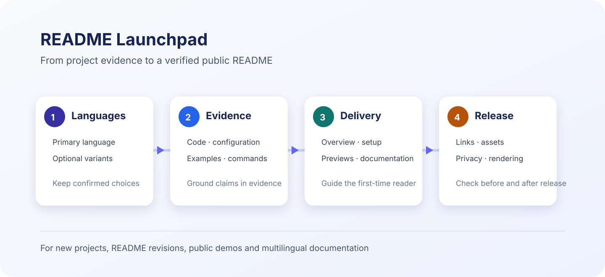

# README Launchpad

[简体中文](README.md) · [English](README.en.md)

> A reusable skill for AI agents with repository access. It turns verified project facts, usable commands, visual evidence, and publishing checks into a clear, maintainable GitHub README.

<p align="center">
  <a href="SKILL.md" title="Read the full workflow">
    
  </a>
  <br>
  <sub>Workflow illustration. Select it to read the complete skill specification.</sub>
</p>

## What it does

The skill helps an agent prepare a repository landing page without inventing facts. It asks the user to choose the primary and optional README languages, verifies claims and commands against the repository, adds useful visual demonstrations, and checks public-facing content for common privacy issues.

## Workflow

| Stage | Agent action | Evidence produced |
| --- | --- | --- |
| 1. Language selection | Reuse confirmed preferences; ask when missing | Visible language links and the requested README files |
| 2. Project verification | Inspect code, manifests, examples, builds, and deployment configuration | Verified description, commands, and links |
| 3. README delivery | Write the landing page, examples, installation path, and documentation entry points | A readable first-visitor experience |
| 4. Publishing checks | Validate relative paths and common sensitive-content patterns | Pre-release checks and post-release inspection |

See the [skill specification](SKILL.md) and the [README playbook](references/readme-playbook.md) for the full procedure.

## Install in Codex

```bash
mkdir -p "${CODEX_HOME:-$HOME/.codex}/skills"
git clone https://github.com/Zimzheng/readme-launchpad.git "${CODEX_HOME:-$HOME/.codex}/skills/readme-launchpad"
```

To update an existing clone:

```bash
cd "${CODEX_HOME:-$HOME/.codex}/skills/readme-launchpad"
git pull --ff-only
```

## Use

```text
Use $readme-launchpad to improve the README in this repository.
Primary language: Simplified Chinese. Optional language: English.
```

The skill asks for a language selection before inspecting or editing a README when that choice is not supplied.

## Validate a README

```bash
python3 scripts/validate_readme.py README.md --repo-root .
python3 scripts/validate_readme.py README.en.md --repo-root .
```

The validator checks titles, relative image and link targets, and common local-path or credential patterns. Review project facts, external links, and visual quality in the target repository as well.

## Repository layout

```text
.
├── SKILL.md
├── README.md
├── README.en.md
├── agents/openai.yaml
├── assets/readme-launchpad-workflow.en.svg
├── references/readme-playbook.md
└── scripts/validate_readme.py
```


## Additional review criteria

- Localize editable previews, captions and alt text alongside the README. Keep authentic screenshots faithful to the real UI.
- Audit accidental assumptions inherited from the original project; separate model, script, host and human responsibilities.
- Document genuinely supported hosts and distinguish file-copy, executable-test, discovery and complete-invocation evidence.
- Distinguish code reuse, dependencies, inspiration and optional acknowledgments; retain required license notices.
- Preserve explicit authorization for the same repository and scope; inspect the actual default-branch page after publication.

## Batch checks and tests

```bash
python3 scripts/validate_readme.py README.md --repo-root . --variants README.en.md
python3 scripts/validate_readme.py README.md --repo-root . --publish-files SKILL.md references/readme-playbook.md
python3 -m unittest discover -s tests -v
```

Relative targets resolve from each README's directory. Space-containing and URL-encoded paths are supported. `--variants` checks the selected documents and their mutual links; `--publish-files` scans specified release texts relative to the repository root. Binary assets need separate review. External URLs, anchors, translation quality, installation and visual behavior are not verified. Pattern scanning cannot establish the absence of all sensitive content.
