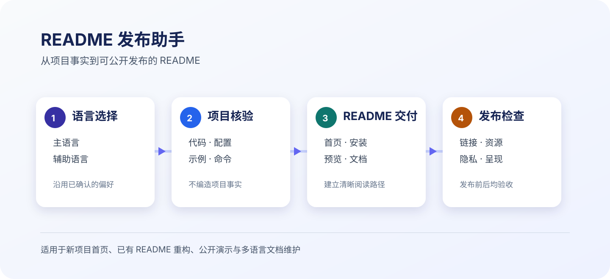

# README Launchpad · README 发布助手

[简体中文](README.md) · [English](README.en.md)

> 面向具备仓库读写能力的 AI Agent 的可复用技能：将项目事实、可验证命令、视觉演示与公开发布检查组织成清晰、可信、可维护的 GitHub README。

<p align="center">
  <a href="SKILL.md" title="查看完整工作流说明">
    
  </a>
  <br>
  <sub>工作流示意图：点击查看技能的完整执行规范。</sub>
</p>

## 它解决什么问题

GitHub README 是新访客理解项目、判断是否值得尝试并完成首次使用的入口。本技能帮助 Agent 在不编造项目事实的前提下，完成以下工作：

- 沿用用户已确定的主语言与辅助语言，缺少选择时才询问；
- 从代码、配置、示例和部署信息中核验项目描述、安装步骤与链接；
- 用截图、示意图或可点击预览呈现可被读者快速判断的效果；
- 为公开仓库清除个人研究、客户信息、本地路径和凭据等不应发布的内容；
- 交付可维护的 README，并运行基础链接、资源与隐私检查。

## 适用场景

| 场景 | 交付重点 |
| --- | --- |
| 新建开源项目首页 | 一句话价值、安装路径、最小可运行示例 |
| 重构已有 README | 信息层级、过期命令、文档入口与阅读路径 |
| 有网页或交互式成果 | GitHub 可显示的预览图，并链接至完整演示 |
| 准备公开发布 | 匿名化示例、相对资源路径、常见隐私风险扫描 |
| 维护多语言文档 | 以 `README.md` 为主版本，明确链接已选择的语言版本 |

## 工作方式

| 阶段 | Agent 的动作 | 形成的证据 |
| --- | --- | --- |
| 1. 语言选择 | 沿用已确认选择，缺少时询问 | 页面顶部的语言入口与对应 README 文件 |
| 2. 项目核验 | 阅读代码、清单、示例、构建和部署配置 | 已验证的价值描述、命令和链接 |
| 3. README 编写 | 组织首页、示例、安装、使用方式和文档入口 | 面向首次访问者的可读页面 |
| 4. 发布检查 | 校验相对路径和常见敏感内容，并复核视觉资产 | 发布前检查与发布后页面验收 |

有关章节选择、可点击演示和公开示例的细则，见 [工作流规范](SKILL.md) 与 [README 编写手册](references/readme-playbook.md)。

## 安装

### Codex

将技能克隆到 Codex 的默认技能目录：

```bash
mkdir -p "${CODEX_HOME:-$HOME/.codex}/skills"
git clone https://github.com/Zimzheng/readme-launchpad.git "${CODEX_HOME:-$HOME/.codex}/skills/readme-launchpad"
```

如果已克隆过该仓库，在其目录内更新：

```bash
cd "${CODEX_HOME:-$HOME/.codex}/skills/readme-launchpad"
git pull --ff-only
```

### 其他支持 `SKILL.md` 的 Agent

本仓库采用通用的 `SKILL.md` 目录结构。将整个 `readme-launchpad` 目录克隆或复制到目标 Agent 已配置的 skills 根目录，并保留其中的 `agents/`、`references/`、`scripts/` 与 `assets/` 子目录。目标 Agent 的技能目录位置以其官方文档或本地配置为准。

## 使用

在任务中直接引用技能，并在同一条请求中给出语言选择即可：

```text
使用 $readme-launchpad 优化当前仓库的 README。
主语言为简体中文，英文作为辅助语言。
```

如果用户尚未说明语言，技能会先询问；同一任务的后续修改沿用已确认选择。

## 交付内容

- 项目名称、明确的一句话说明和面向访客的首要行动；
- 经项目文件核验的安装及运行命令；
- 适合 GitHub Markdown 的视觉演示；如有完整页面或交互样例，使用可点击预览图连接；
- 与项目实际需要相匹配的使用、架构、示例、文档、贡献或安全说明；
- 已选择语言版本之间可见的跳转链接；
- 发布前的相对链接、资源路径和常见敏感信息检查结果。

## 本地校验

校验 README 标题、相对图片与链接，以及常见本地路径和凭据模式：

```bash
python3 scripts/validate_readme.py README.md --repo-root .
python3 scripts/validate_readme.py README.en.md --repo-root .
```

校验器覆盖可机械确认的基础条件。项目事实、外部链接的有效性和视觉质量仍应结合实际项目、预览结果与公开页面复核。

## 仓库结构

```text
.
├── SKILL.md                         # Agent 工作流与边界
├── README.md                        # 中文主 README
├── README.en.md                     # 英文辅助 README
├── agents/openai.yaml               # Codex 界面元数据
├── assets/readme-launchpad-workflow.svg # GitHub 首页工作流图
├── references/readme-playbook.md    # README 信息架构与视觉演示规范
└── scripts/validate_readme.py       # 零依赖校验器
```


## 新增的审查重点

- 正文、可编辑示意图、图注与替代文本按阅读语言配套；真实截图保持真实界面。
- 通用化时检查原项目残留，明确模型、脚本、宿主与人工判断各自的能力。
- 按实际支持范围说明多宿主安装和调用，分别记录复制、测试、发现与完整调用证据。
- 区分代码复用、依赖、方法启发与可选致谢；保留必要许可声明。
- 沿用同一仓库和范围内的明确发布授权，发布后检查实际默认分支、图片与入口。

## 批量检查与测试

```bash
python3 scripts/validate_readme.py README.md --repo-root . --variants README.en.md
python3 scripts/validate_readme.py README.md --repo-root . --publish-files SKILL.md references/readme-playbook.md
python3 -m unittest discover -s tests -v
```

相对链接从各 README 所在目录解析，支持带空格和 URL 编码路径。
`--variants` 检查指定版本及彼此链接；`--publish-files` 扫描相对仓库根目录指定的发布文本。
二进制文件需另行审查。校验器不验证外部网址、页内锚点、翻译正确性、安装可用性或视觉效果，也不保证检测所有敏感内容。
