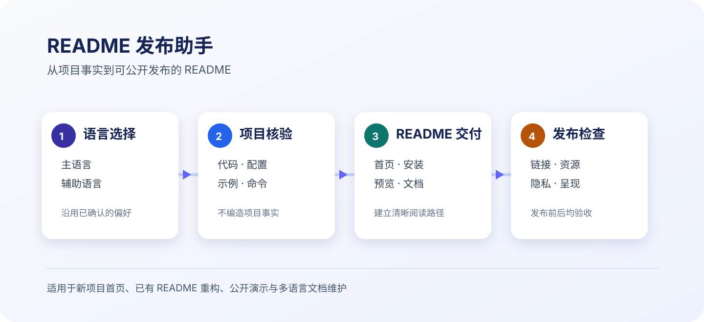

# README Launchpad

[简体中文](README.md) · [English](README.en.md)

**让 AI Agent 把项目事实整理成清晰、可信、方便上手的 GitHub README。**

适合新建项目首页、整体重写、定点修订和文档审查。先理解项目当前能做什么，再组织效果、能力、安装与使用；更新时同步修正旧内容，保持整篇说明一致。

[安装](#安装) · [使用](#使用) · [完整技能规则](SKILL.md)

[](SKILL.md)

上图为工作流示意，点击查看执行规则；并非成品 README 截图。

## 能帮你做什么

- **组织阅读路径**：让首次访问者快速理解项目、判断效果并找到开始使用的入口，不强制固定章节模板。
- **整体维护内容**：按当前产品能力更新定位、示例、命令和限制；合并重复说明，把版本历史留给发布记录。
- **核验而非编造**：结合代码、配置与可用示例检查事实、命令和支持范围，区分已验证内容与尚未验证的声明。
- **设计有用的演示**：选择截图、图表或可点击预览，明确区分真实输出与示意图，链接到可用的演示或源文件。
- **保持多语言一致**：沿用选定的主语言和辅助语言，同步更新文字、图注、链接与能力边界。
- **检查公开发布内容**：检查内部链接、资源路径与常见敏感信息，精简来源说明并保留必要署名和许可证。

整体优化会检查整篇；只要求修复某个部分时，技能保持修改范围，不擅自重写其他章节。

## 安装

需要能够读取仓库、编辑文件和执行本地命令的 Agent。安装使用 Git；机械校验器只依赖 Python 3 标准库，不需要 API Key 或额外 Python 包。

在 Codex 中安装：

```bash
mkdir -p "${CODEX_HOME:-$HOME/.codex}/skills"
git clone https://github.com/Zimzheng/readme-launchpad.git "${CODEX_HOME:-$HOME/.codex}/skills/readme-launchpad"
```

更新已有克隆前，先保存自己的修改，然后执行：

```bash
cd "${CODEX_HOME:-$HOME/.codex}/skills/readme-launchpad"
git pull --ff-only
```

其他支持 `SKILL.md` 的 Agent 可按其配置加载完整技能目录；保留 `agents/`、`references/`、`scripts/` 和 `assets/`。具体路径与发现机制以目标环境为准。

## 使用

```text
使用 $readme-launchpad 整体优化当前仓库的 README。
主语言为简体中文，英文作为辅助语言。
按项目当前能力重新组织说明，更新旧内容，保持简洁清晰。
```

也可以缩小任务范围：

```text
只检查并修正安装章节和对应英文，不改其他内容。
```

或只请求审查：

```text
审查 README 的事实、上手路径和信息层级，列出问题与建议，先不修改。
```

语言选择缺失时会询问；同一任务沿用已确认的选择。技能输出实际 Markdown 和必要的视觉资产，并说明执行过的检查与未验证事项。公开推送、建仓或开启托管需要相应授权，已有授权在同一范围内沿用。

## 校验与边界

在技能仓库中检查自身 README 并运行校验器测试：

```bash
python3 scripts/validate_readme.py README.md --repo-root . --variants README.en.md
python3 -m unittest discover -s tests -v
```

检查其他仓库时，将脚本路径指向技能安装位置，并传入目标仓库的 README 与 `--repo-root`。额外发布文本可通过 `--publish-files` 指定，详见 `python3 scripts/validate_readme.py --help`。

机械检查覆盖标题、语言版本链接、相对图片与文件目标，以及常见本地路径和凭据模式；支持空格和 URL 编码路径。它不验证外部网址、页内锚点、翻译、安装可用性或视觉质量，也不保证发现所有敏感信息。事实核验、页面检查和二进制资产审查仍由 Agent 结合实际环境完成。

## 进一步了解

[技能规则](SKILL.md) · [编写与维护手册](references/readme-playbook.md) · [视觉设计](references/visual-design.md) · [验证与交付](references/verification.md)

技能负责指导 Agent 工作，校验脚本提供机械检查；仓库访问、命令执行、浏览器和发布能力由宿主环境提供。实际可完成的检查应以当次执行证据为准。
